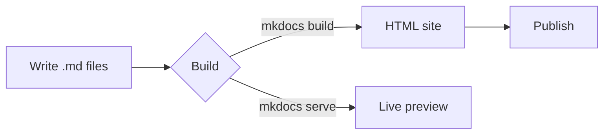
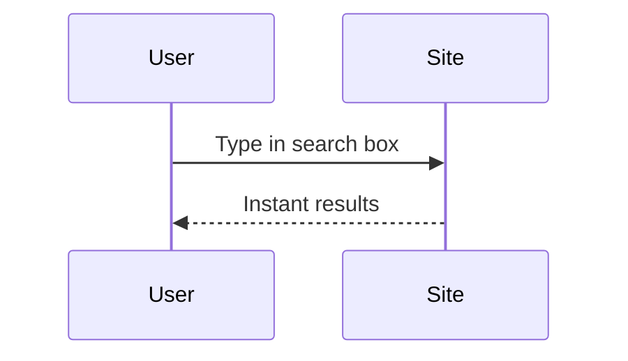
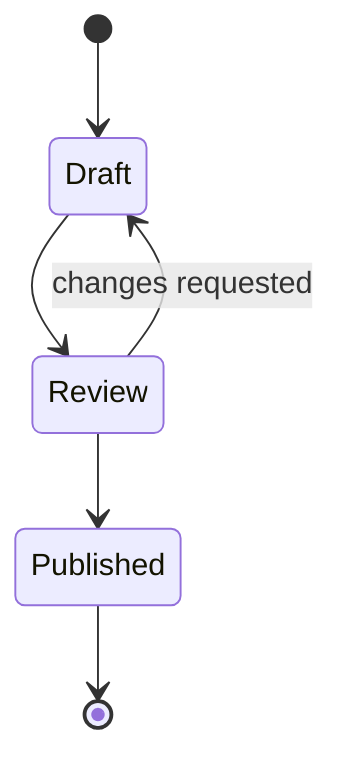
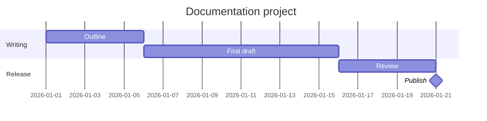
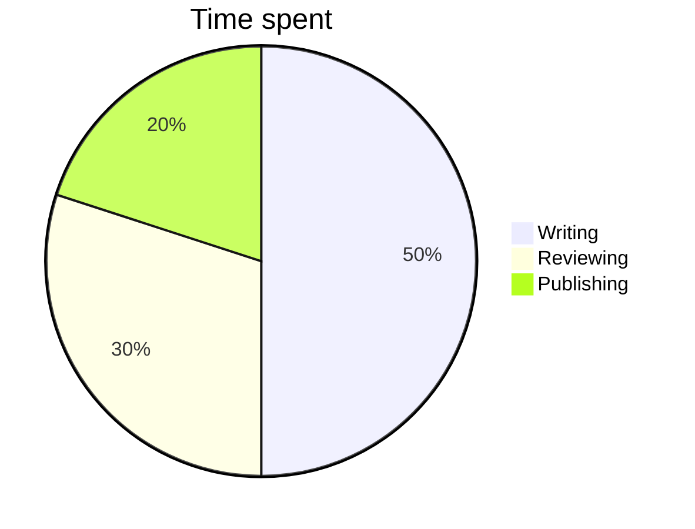
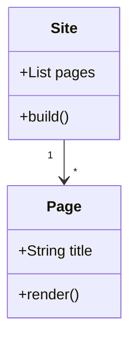

# Diagrams and Math

## Flowchart

## Sequence diagram

## State diagram

## Gantt chart

## Pie chart

## Class diagram

## Math (LaTeX)

Inline math: \(E = mc^2\) and \(a^2 + b^2 = c^2\).

Display math:

\[
\int_0^\infty e^{-x^2}\,dx = \frac{\sqrt{\pi}}{2}
\]

A matrix:

\[
A = \begin{pmatrix} a & b \\ c & d \end{pmatrix}, \qquad
\det A = ad - bc
\]

Aligned equations:

\[
\begin{aligned}
(a+b)^2 &= a^2 + 2ab + b^2 \\
(a-b)^2 &= a^2 - 2ab + b^2
\end{aligned}
\]

Greek letters and sums: \(\alpha, \beta, \gamma, \sum_{i=1}^{n} i = \frac{n(n+1)}{2}\)
